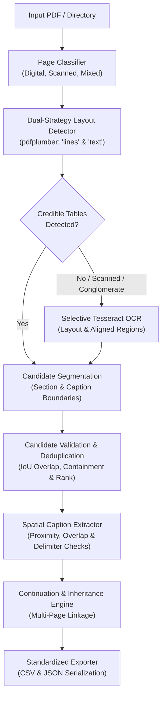

# Financial PDF Table Detection & Title Extraction

A Python solution for detecting physical tables in financial PDF documents, extracting their associated titles and captions, and exporting structured metadata in CSV and JSON formats.

Designed to support different financial document types:

- **Annual Reports & Disclosures:** Balance Sheets, Profit & Loss Statements, Cash Flow Statements, Statements of Changes in Equity, Notes to Accounts.
- **Banking & Commercial Statements:** Bank Transaction Statements, Account Summaries, Commercial Invoices.
- **Document Modalities:** Pure digital PDFs, scanned image-based PDFs, mixed digital/scanned pages.
- **Layout Variations:** Fully bordered tables, semi-bordered tables, completely borderless whitespace-aligned grids.

---

## Output Specifications

For every processed PDF `<document>.pdf`, the pipeline outputs two files in the target output directory:

- `<document>_tables.csv`
- `<document>_tables.json`

Both files follow the required schema:

| Column / Key | Type | Description |
|:---|:---|:---|
| `Table Title` | string | Title or caption associated with the table (`Untitled table` if no heading exists) |
| `Page Number` | integer | 1-based page number where the table appears in the PDF |

### Continuation Handling

Multi-page tables spanning across page boundaries are reported on each page they appear. When a continuation table lacks an explicit heading at the top of a subsequent page, the preceding statement title is carried forward based on physical layout geometry, page-boundary adjacency, and section context.

---

## Tools and Libraries Used

The project uses Python and supporting libraries for PDF processing, table detection, OCR, data extraction, and automated testing.

| Tool / Library | Purpose | Why It Was Used |
|---|---|---|
| Python 3.10+ | Core programming language | Provides flexibility for PDF processing, layout analysis, and data extraction. |
| pdfplumber | PDF text and layout extraction | Extracts text, lines, and geometric coordinates required for identifying physical table structures. |
| Tesseract OCR | Optical Character Recognition | Recognizes text in scanned and image-based PDF documents. |
| pytesseract | Python interface for Tesseract | Integrates Tesseract OCR functionality into the Python application. |
| pytest | Automated testing framework | Tests individual modules and verifies application functionality. |
| CSV | Structured output format | Stores extracted table titles and page numbers in a spreadsheet-compatible format. |
| JSON | Structured output format | Stores extracted metadata in a machine-readable format suitable for further processing. |

### Development Tools

- **Visual Studio Code:** Used for Python development, debugging, and project management.
- **Git and GitHub:** Used for source-code version control and project hosting.

## System Architecture



---

## Tools and Libraries Used

The project uses Python and supporting libraries for PDF processing, layout analysis, OCR, and automated testing.

| Tool / Library | Purpose | Rationale |
|---|---|---|
| Python 3.10+ | Core implementation | Provides a flexible environment for PDF processing and data extraction. |
| pdfplumber | PDF text and layout extraction | Provides access to text, lines, and geometric coordinates useful for identifying table structures. |
| Tesseract OCR | Optical Character Recognition | Extracts text from scanned and image-based PDF pages. |
| pytesseract | Python interface for Tesseract | Integrates OCR functionality into the Python processing pipeline. |
| pytest | Automated testing | Supports repeatable testing of detection, extraction, and export functionality. |
| CSV | Structured result export | Produces a format compatible with spreadsheet applications and data-processing tools. |
| JSON | Structured metadata export | Provides machine-readable output for other applications and processing workflows. |

---

## Key Technical Features

1. **Deterministic Layout Analysis:**
   - Evaluates vector path rules (`lines` strategy) for bordered tables.
   - Infers column boundaries and row gutters using whitespace alignment (`text` strategy) for borderless schedules.
   - Calculates candidate quality metrics: cell occupancy, multi-cell row ratios, column stability, and average word counts.

2. **Contextual Document Segmentation:**
   - Detects numbered notes, schedules, and structural section headers.
   - Prevents unbordered native text from collapsing multiple distinct schedules into a single unsegmented table block.
   - Slices conglomerate page regions into distinct physical tables bounded by their respective headings.

3. **Selective High-Resolution OCR Fallback:**
   - Invoked for scanned pages or image-backed pages with insufficient native text extraction.
   - Evaluates OCR word bounding boxes and lines to detect aligned columns and tabular grids.
   - Supports non-numeric and NIL indicator rows (`NIL`, `N/A`, `None`, `-`), ensuring non-numeric financial disclosures can be retained.

4. **Spatial Title Association & Cleaning:**
   - Prioritizes structural note headings (e.g. `Note 3 : Property, Plant And Equipment`), primary statements, and schedule titles.
   - Distinguishes table titles from running headers, page navigation bars, table column headers, and narrative prose.
   - Applies domain-safe OCR token normalization to resolve character confusions without corrupting valid words.

5. **Precision Deduplication:**
   - Compares candidate bounding boxes using Intersection over Union (IoU), spatial containment, and row structure.
   - Retains physically distinct adjacent tables sharing identical note headings while deduplicating genuine spatial duplicates.

---

## Installation & Setup

### Prerequisites

- **Python 3.10+**
- **Tesseract OCR** (required for scanned document fallback):
  - **Windows:** Download and install the Tesseract OCR installer and add the installation directory to your system `PATH`.
  - **Linux (Ubuntu/Debian):** `sudo apt-get install tesseract-ocr`
  - **macOS:** `brew install tesseract`

### Virtual Environment Setup

```bash
# Create virtual environment
python -m venv venv

# Activate virtual environment
# Windows (PowerShell):
.\venv\Scripts\Activate.ps1

# Linux / macOS:
source venv/bin/activate

# Upgrade pip and install dependencies
pip install --upgrade pip
pip install -r requirements.txt
```

### Build and Execution Workflow

1. Clone the GitHub repository.
2. Install Python 3.10+ and Tesseract OCR.
3. Create and activate a Python virtual environment.
4. Install the required dependencies using `pip install -r requirements.txt`.
5. Place PDF documents in the input directory.
6. Run the application using the provided command-line instructions.
7. Inspect the generated CSV and JSON output files.
8. Execute the automated test suite.
9. Run the output validation utility.

---

## Usage

### 1. Process All PDFs in a Directory

```bash
python main.py data/input -o data/output
```

### 2. Process a Single PDF Document

```bash
python main.py data/input/annual_report.pdf -o data/output
```

### 3. Disable OCR Fallback (Digital-Only Mode)

```bash
python main.py data/input --no-ocr
```

### CLI Arguments

| Argument | Flag | Default | Description |
|:---|:---|:---|:---|
| `input` | Positional | *Required* | Path to a single PDF file or directory containing PDFs |
| `--output` | `-o` | `data/output` | Destination directory for generated CSV and JSON files |
| `--no-ocr` | Flag | `False` | Disable Tesseract OCR fallback for pure-digital environments |

---

## Validation & Testing

### Run Automated Unit Tests

The test suite validates layout extraction, caption parsing, delimiter balancing, and exporter conformity.

```bash
python -m pytest
```

### Run Output Verification Tool

The repository includes a validation utility (`validate.py`) that audits generated CSV and JSON outputs for schema conformity, record parity, page number bounds, and title integrity.

```bash
python validate.py --output data/output --input data/input --strict
```

See [VALIDATION.md](VALIDATION.md) for detailed validation records and benchmarks.

---

## Project Structure

```text
financial-pdf-table-detection/
├── data/
│   ├── input/                     # Input PDF documents
│   └── output/                    # Generated CSV and JSON results
├── src/
│   ├── __init__.py
│   ├── main.py                    # CLI execution controller
│   ├── table_detector.py          # Core detection, segmentation, and deduplication
│   ├── title_extractor.py         # Heading extraction and title normalization
│   ├── ocr_processor.py           # Tesseract OCR fallback and layout analysis
│   ├── page_classifier.py         # Modal page classifier (digital vs scanned)
│   ├── native_table_detector.py   # Vector path metric analysis
│   ├── result_exporter.py         # CSV and JSON serialization
│   ├── pdf_processor.py           # PDF document inspection utilities
│   ├── detection_audit.py         # Diagnostic visual review generator
│   └── table_debugger.py          # Page-level diagnostics
├── tests/
│   ├── test_title_extractor.py
│   ├── test_detector_helpers.py
│   ├── test_ocr_processor.py
│   ├── test_exporter.py
│   └── test_startup.py
├── validate.py                    # Automated validation script
├── VALIDATION.md                  # Detailed validation documentation
├── main.py                        # Repository root entrypoint
├── requirements.txt               # Python package requirements
├── LICENSE                        # Apache 2.0 license
└── README.md                      # Project documentation
```

---

## Security & Privacy

- **Local Processing:** Document parsing and OCR execution are performed locally by the processing pipeline; document contents are not transmitted to external services.
- **Sensitive Data Protection:** `.gitignore` excludes local environment artifacts, cache directories, and other unnecessary files from version control.
- **Credential Safety:** The repository should not contain hardcoded credentials, API keys, passwords, or personal information.

---

## License

Released under the [Apache License, Version 2.0](LICENSE).
